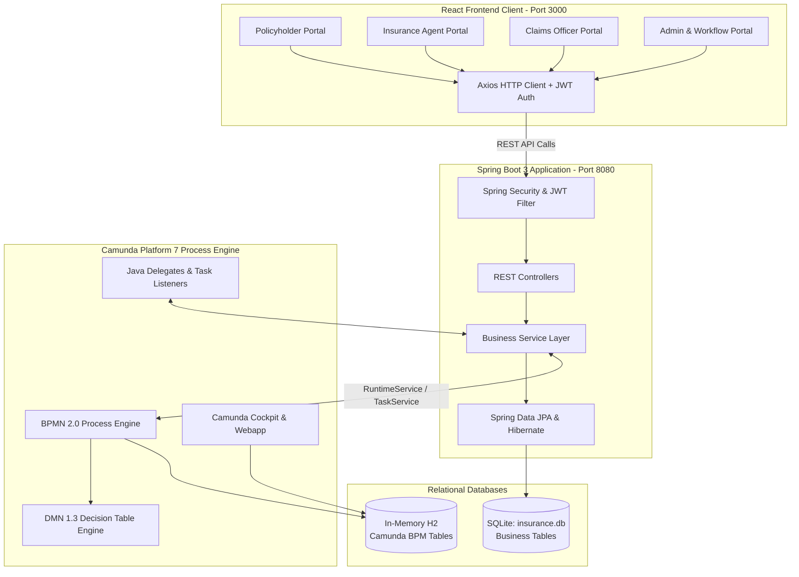
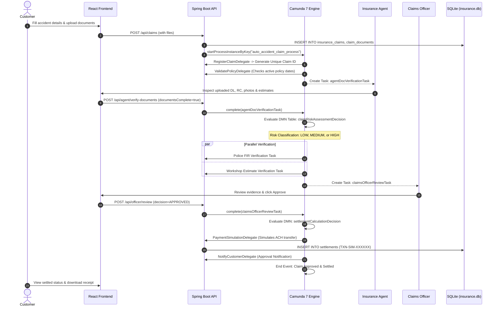
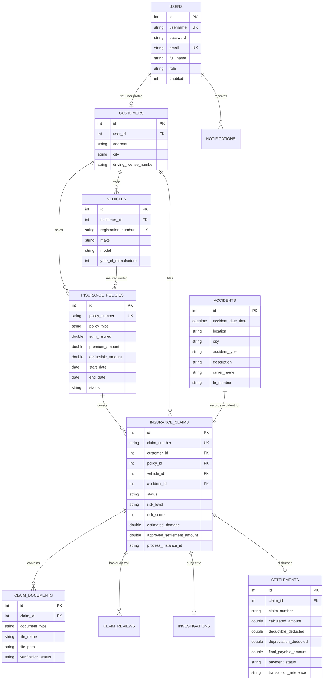
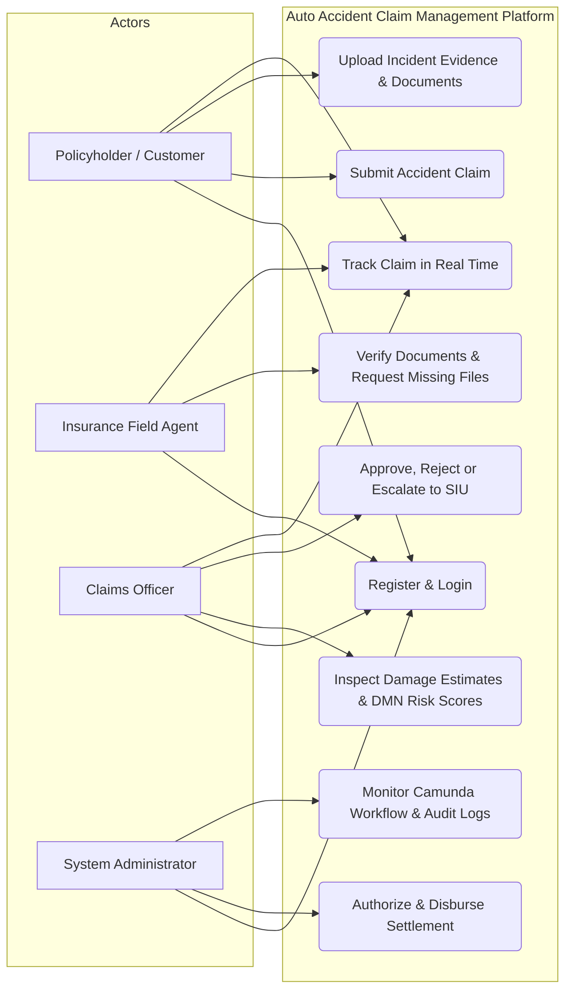

# System Architecture & Technical Specification

## 1. High-Level Architecture Overview

The **Auto Accident Insurance Claim Management System** is built on a multi-tier enterprise architecture combining **React.js** for modern responsive user interfaces, **Spring Boot 3** for core RESTful services and business entities, **Camunda Platform 7** for orchestrating complex BPMN 2.0 workflows and DMN 1.3 decision tables, and **SQLite** (`insurance.db`) for lightweight, serverless relational persistence.

---

## 2. Sequence Diagram: End-to-End Claim Lifecycle

---

## 3. Entity-Relationship (ER) Diagram

---

## 4. Use Case Diagram

